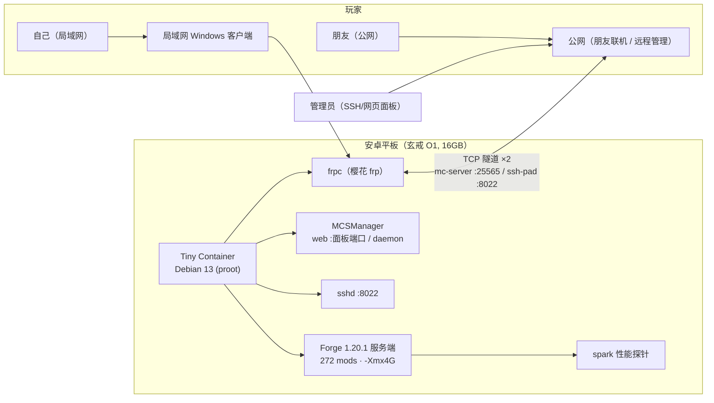

# 平板 MC 服务器 — 在 Android 平板的 Debian 容器里跑 272-mod Forge 服

在安卓平板（玄戒 O1）的 **Tiny Container（Debian 13, proot）** 里跑 **Forge 1.20.1 + 272 mods** 的
Minecraft 服务端，配合 MCSManager 面板（网页启停/日志/文件管理）与樱花 frp 内网穿透，
实现**低功耗 7×24 挂机 + 远程管理 + 公网联机**的完整闭环。

> 本仓库是**教程 + 脚本**，不含任何 mod / 整合包 / 世界存档（版权归原作者）。
> 文中 IP、密钥、隧道 ID、实例 UUID 均为占位符。

## 为什么把服务端搬到平板

- 笔记本开服 + 本机玩 = 服务端和客户端**抢同一颗 CPU、同一份内存**，两边都卡；
- 服务端搬到平板独立挂机后，电脑专职当客户端（modpack、光影全拉满），两边互不抢资源；
- 平板功耗 ~3W，7×24 挂机的电费可以忽略。

## 架构

**存储布局**：服务端实例由 MCSManager 托管在
`/opt/mcsmanager/daemon/data/InstanceData/<UUID>/server/`，
世界备份用 `tar` 打包后拉回 Windows 侧网盘同步目录（停服后热备份防损坏）。

**编排方式**：容器内没有 systemd（proot 限制），用免密 sudo + 登录自动拉起的
[start-services.sh](scripts/start-services.sh)（sshd / frpc / MCSManager 三进程，pgrep 幂等防重复启动）。

## 实测性能（272 mods，spark 采样）

| 场景 | CPU 亲和性 | Tick 中位 | Tick 95%ile | TPS |
|---|---|---|---|---|
| 空载（大核被锁） | 0-4 | 45 ms | 77 ms | 20 |
| 空载（**大核解锁**） | **2-9** | **33 ms** | 45 ms | 20 |

- 堆内存实测 2.3 GB（`-Xmx4G` 富余），瓶颈在**主线程 tick**（区块生成 / mod 事件），不是内存/GC；
- 物理内存 11.8 / 15.2 GB（系统 + 桌面 + 全部服务共存）。

## 最难的三个坑（复盘）

### 坑 1：proot 容器的 CPU 大核被 cpuset 锁死 —— 单核性能凭空损失 27%

**现象**：TPS 能跑满 20，但 2 人以上就掉；崩溃报告里写 `CPUs: 5`。
**根因**：安卓把 proot 容器的 java 进程 affinity 锁在核心 0-4（小核 + 能效核），
够不到大核 X925；`taskset` 在 proot 里**改不动**（报无效参数）。
**解法**：平板开**性能/游戏模式 + 完全重启 Tiny Container**（不是重启 MC 实例！
affinity 在容器启动时决定）→ 亲和性变 2-9，tick 中位 45ms → 33ms（**-27%**）。
**教训**：崩溃报告的 `CPUs: 5` 是亲和性假象，不是硬件只有 5 个核；先查调度，再怀疑 mod。

### 坑 2：chunky 预生成踩中 mod 世界生成 bug —— 单 tick 卡 60 秒被 Watchdog 击杀

**现象**：预生成殖民地区域时速率从 1400 cps 暴跌到 2 cps，随后服务器崩溃。
**根因链条**：mod 生成器产出无效坐标（`Empty height range`）→ chunky 降级到主线程 →
塞入 **180 万个计划方块 tick**（崩溃报告 `block_ticks: 1,809,670`）→ 单 tick 60s →
ServerWatchdog 判定崩溃强制关服。
**解法**：看到速率暴跌/`Can't keep up!` 立即 `chunky cancel` 止损，换 center 或缩小半径；
有 bug 的区域跳过不生成（玩家真探索到再排查）。
**教训**：预生成不是无脑 `chunky start`，`center` 必须指向玩家活动区；崩溃时先看
`block_ticks` 数量级，180 万的数字直接指向"生成器塞 tick"而非内存不足。

### 坑 3：Debian 13 软件源没有 openjdk-17，而 Forge 1.20.1 只认 17

**现象**：`apt install openjdk-17-jre` 报"没有可安装候选"。
**根因**：Debian 13 (trixie) 源里只有 JDK 21。
**解法**：手动装 Eclipse Temurin 17（ARM64 JRE，清华镜像直连比 GitHub 稳，
解压到 `/opt/java17` + `ln -sf` 进 PATH）。
**连带坑**：MCSManager 安装脚本带的是 x86 Node.js，ARM 上要手动换成
`node-v20-linux-arm64` 并重新挂 `/usr/local/bin/node` 软链。

其余 proot 限制（<1024 端口、netlink 受限、无 systemd、scp 需 `-O`）与解法
见 [部署手册](docs/平板MC服务器-从零部署手册-公开版.md) 附录。

## 快速开始

1. 完整部署（从零到公网联机）：**[docs/平板MC服务器-从零部署手册-公开版.md](docs/平板MC服务器-从零部署手册-公开版.md)**
2. 日常运维指令速查：**[docs/平板MC服务器-指令手册-公开版.md](docs/平板MC服务器-指令手册-公开版.md)**
3. 一键启动脚本模板：**[scripts/start-services.sh](scripts/start-services.sh)**

## 实测环境

| 项目 | 配置 |
|---|---|
| 平板 | 小米平板 7S Pro（16GB+512GB，玄戒 O1 十核） |
| 容器 | Tiny Container（Debian 13, proot） |
| 服务端 | Forge 1.20.1 + 272 mods（剑与王国整合包） |
| 面板 | MCSManager（Node 20 ARM64） |
| 穿透 | 樱花 frp（natfrp） |

## 已知问题 / 注意事项

- **proot 环境限制**：不能绑 <1024 端口（SSH 用 8022）、netlink 受限（`ip`/`hostname` 不可用）、无 systemd、Java 需手动装 Temurin 17
- **CPU 亲和性**：容器内 java 默认锁小核，需"性能模式 + 重启容器"解锁大核（见坑 1）
- **chunky 生成 bug**：部分 mod 生成器在特定坐标有 bug，预生成可能触发崩溃（见坑 2）
- **mod 兼容性**：部分 JNI mod 在 ARM 上不兼容（`UnsatisfiedLinkError`），以实际日志为准

## 免责声明

- 本仓库仅含教程与脚本，**不含任何 mod / 整合包 / 世界存档**，请自行准备并遵守各 mod 许可证；
- 教程中的 IP、密钥、隧道 ID、实例 UUID 等均为占位符，请替换为你自己的值；
- proot 下运行 Java 服务端有性能损耗，大型整合包建议 4 人以内游玩。

## 许可证

[MIT](LICENSE)
